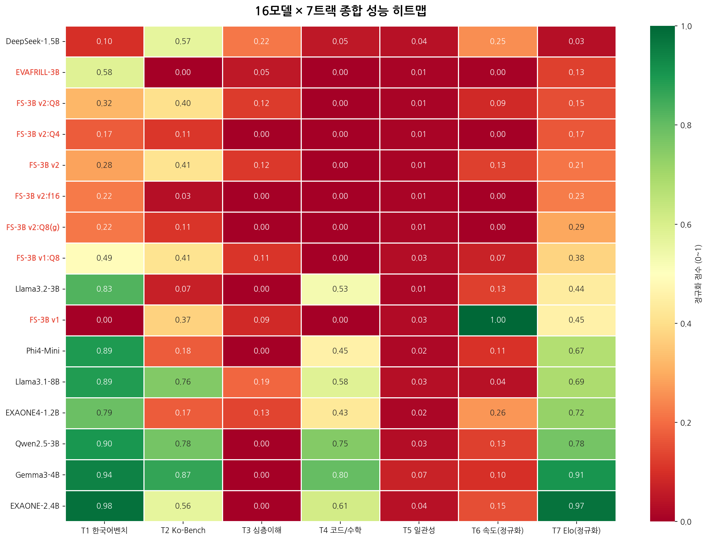
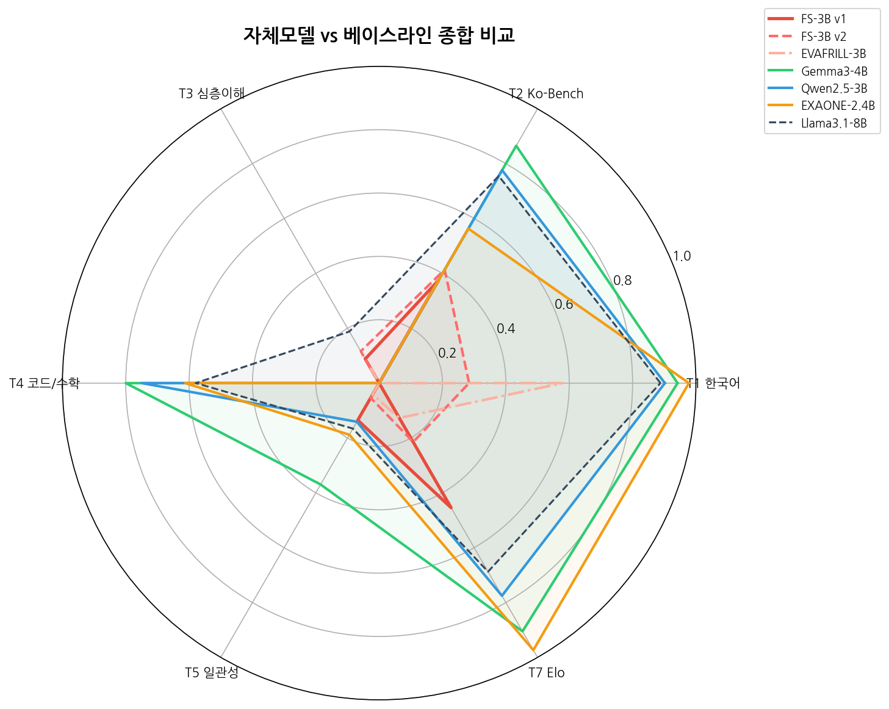
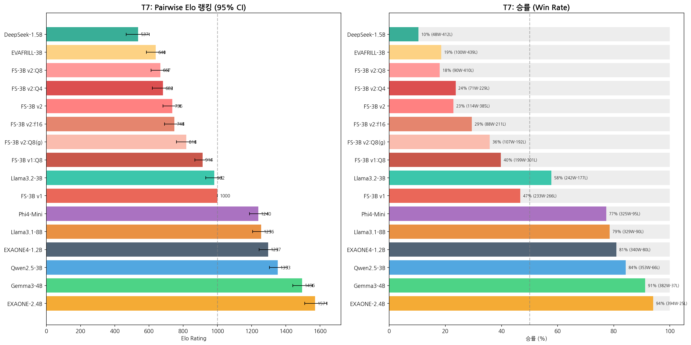

# KoBench Suite (ko-llm-bench-suite)

[English](README_EN.md)

한국어 LLM 평가 도구. 공개 표준 벤치마크를 같은 조건으로 돌리는 **표준 벤치 모듈**과, 자체 문항으로 생성 품질·일관성·속도를 보는 **7개 트랙**으로 이루어져 있다.

[](LICENSE)
[](https://www.python.org)
[](tests/)
[](https://pathcosmos.github.io/ko-llm-bench-suite/)

**최종 보고서: <https://pathcosmos.github.io/ko-llm-bench-suite/>** — 직접 만든 3B 모델 3종과 공개 모델 30개(dense 3B급, MoE A3B급)를 H200 한 장에서 같은 조건으로 비교했다.

---

## 목차

- [구성](#구성)
- [최종 보고서와 주요 결과](#최종-보고서와-주요-결과)
- [빠른 시작](#빠른-시작)
- [표준 벤치마크](#표준-벤치마크-kobenchstandard)
- [7개 평가 트랙](#7개-평가-트랙)
- [시스템 요구사항](#시스템-요구사항)
- [프로젝트 구조](#프로젝트-구조)
- [테스트](#테스트)
- [예제: Frankenstallm 평가 결과 (v0.2)](#예제-frankenstallm-평가-결과-v02)
- [운영 기능](#운영-기능) (원격 Ollama, EVAFRILL 모드, 체크포인트, 멀티머신, 위저드, 대시보드)

## 구성

| 구성 | 실행 | 하는 일 |
|---|---|---|
| **표준 벤치** (`kobench/standard`) | `python -m kobench.standard.*` | lm-evaluation-harness·vLLM(BF16)·llama.cpp로 공개 벤치마크를 같은 조건에서 실행한다. 객관식은 선택지 로그우도, PPL은 bits-per-byte로 채점해 base 모델도 공정하게 비교한다. 생성 13종(규칙·코드 실행·LLM judge), 다턴 시나리오, thinking on/off, 통일 비교 프로토콜, 서빙 성능, GGUF 양자화 손실, dev 기반 설정 선택, bootstrap CI를 포함한다. |
| **7개 트랙** (`kobench.py`) | `python kobench.py --config ...` | 자체 문항으로 KoBEST, 한국어 생성(이중 judge), 심층 이해, 코드·수학, 일관성, 속도, Pairwise Elo를 본다. 백엔드는 Ollama, vLLM·llama.cpp(OpenAI 호환), EVAFRILL. |

두 구성은 독립적이다. 공개 모델과 정밀하게 비교하려면 표준 벤치를, Ollama로 빠르게 여러 모델을 훑으려면 7개 트랙을 쓴다.

## 최종 보고서와 주요 결과

보고서: **<https://pathcosmos.github.io/ko-llm-bench-suite/>** (원본 [`reports/final/report.html`](reports/final/report.html), 해설 [`narrative.json`](reports/final/narrative.json), 차트 데이터 [`data.json`](reports/final/data.json)). 2026-11 측정, H200 1장, vLLM 0.33 BF16.

- **비교 대상**: JANSORI(3B base), frankenstallm(3B instruct), EVAFRILL-Mo(2.94B Mamba-2 하이브리드, pretrain·slerp)와 공개 모델 30개 — Qwen3.5/3.6·Qwen3·Qwen2.5, kanana-1.5/2, SmolLM3, Gemma 4, Llama 3.2, Phi-4-mini, EXAONE 3.5, Nemotron 3/3.5, ERNIE 4.5. base끼리, instruct끼리 비교하고 MoE는 총/활성 파라미터를 함께 적는다.
- **설정 선택**: 모델별 설정(디코딩·시스템 지시·체크포인트)은 dev 분할에서만, 측정 전에 정한 규칙으로 골랐다. test 결과는 선택에 쓰지 않았다.

### 통일 비교 (34개 모델, 한 줄)

chat 템플릿 없이 모든 모델에 같은 원문 프롬프트(로그우도 cloze, few-shot, URIAL)를 넣고, 9개 영역(지식, 전문·의료, 사실성·편향, 수학, 코드, 지시 수행, 대화·생성 품질, 다턴, 언어 모델링)을 같은 가중치로 평균했다(0~1).

| 순위 | 모델 | 구분 | 총/활성 파라미터 | 종합 |
|---:|---|---|---|---:|
| 1 | qwen3.6-35b-a3b | instruct, MoE | 35B / 3B | 0.585 |
| 2 | qwen3.5-35b-a3b | instruct, MoE | 35B / 3B | 0.581 |
| 3 | qwen3.5-35b-a3b-base | base, MoE | 35B / 3B | 0.577 |
| 4 | qwen3-30b-a3b-2507 | instruct, MoE | 30.5B / 3.3B | 0.571 |
| 8 | qwen3-4b-2507 (dense 최고) | instruct, dense | 4.0B | 0.492 |
| 10 | exaone-3.5-2.4b | instruct, dense | 2.4B | 0.467 |
| 30 | llama-3.2-3b (공개 모델 최하위) | base, dense | 3.2B | 0.246 |
| 31 | **JANSORI** | base, dense | 3.2B | 0.181 |
| 32 | **EVAFRILL-Mo slerp** | instruct, 하이브리드 | 2.94B | 0.155 |
| 33 | **frankenstallm** | instruct, dense | 3.0B | 0.152 |
| 34 | **EVAFRILL-Mo pretrain** | base, 하이브리드 | 2.94B | 0.151 |

### 그 밖의 관찰

- **언어 모델링만 상위권**: 한국어 bits-per-byte(wiki40b_ko)에서 JANSORI는 0.752로 base 15개 중 4위다. 지식형 객관식(KMMLU, HAE-RAE, Belebele 등)은 사용자 모델 3종 모두 무작위 수준 근처이고, 수학·코드는 0에 가깝다.
- **객관식(ko_mc_v1 평균)**: base 1위 kanana-2-30b-a3b-base 74.7, dense base 1위 qwen3-4b-base 64.1, JANSORI 29.6, EVAFRILL pretrain 28.4.
- **thinking 샘플링**: qwen3.5-4b thinking을 greedy로 돌리면 생각이 문맥 끝까지 이어져 잘린다. README 권장 샘플링으로 다시 돌리면 IFEval-Ko 31.9→79.2%, KorMedMCQA 62.1→80.1%, 다턴 시나리오 통과 0.31→0.82로 오른다.
- **서빙 성능**: 동시 요청 64에서 MoE A3B의 출력 처리량(약 3.5~4.8k tok/s)은 dense 3~4B(약 9~15k tok/s)의 1/4~1/2 수준이다. 매 단계 30B급 가중치를 읽는 메모리 대역 한계와 맞는다.
- **GGUF 양자화**: Q8_0은 f16 GGUF와 차이가 95% CI 안이다. Q4_K_M은 JANSORI KoBEST에서 −0.9%p [−1.8, −0.2]로 유의한 손실이 있다.
- **주의**: 통일 비교의 코드 태스크는 base 이어쓰기 형식이라 이 형식을 따르지 않는 일부 instruct 모델은 MBPP+가 0에 가깝다. judge(Qwen3.6-35B-A3B)와 같은 Qwen 계열의 judge 점수는 자기 선호 편향이 있을 수 있다. 공개 벤치마크는 공개 모델의 학습 데이터에 섞였을 수 있다. 측정 중 찾아 고친 버그와 그 영향은 보고서 부록에 적었다.

## 빠른 시작

```bash
git clone https://github.com/pathcosmos/ko-llm-bench-suite.git
cd ko-llm-bench-suite
pip install -r requirements.txt          # 7개 트랙
pip install -r requirements-dev.txt      # 테스트 (선택)
```

### 표준 벤치

CUDA GPU가 필요하다. 검증한 버전은 [`requirements-standard.txt`](requirements-standard.txt)에 고정했다(vLLM 0.33.0, lm-eval 0.4.13). 새 venv에 설치하기를 권한다.

```bash
pip install -r requirements-standard.txt
python -c "import nltk; nltk.download('punkt_tab')"            # IFEval 채점기 데이터

python -m kobench.standard.run --list                                         # 모델·스위트, revision 고정 여부
python -m kobench.standard.run --download --models qwen3-4b-base              # 고정 revision으로 내려받기
python -m kobench.standard.run --models qwen3-4b-base --suite ko_mc_v1        # 객관식 (완료 태스크는 건너뜀)
python -m kobench.standard.gen run   --models qwen3-4b-2507 --suite gen_v1 --variant A   # 생성
python -m kobench.standard.gen score --models qwen3-4b-2507 --suite gen_v1 --variant A   # 규칙·코드 채점
python -m kobench.standard.judge run --models qwen3-4b-2507 && python -m kobench.standard.judge score
python -m kobench.standard.perf --models qwen3-4b-2507                        # 서빙 성능
python -m kobench.standard.final_data --regen && python -m kobench.standard.final_report   # 보고서
```

### 7개 트랙

```bash
bash setup.sh                            # Ollama + judge 모델 자동 설치 (또는 아래 수동 설치)
ollama pull qwen2.5:7b-instruct && ollama pull exaone3.5:7.8b     # judge
ollama pull qwen2.5:3b                   # 평가 대상 (예시)

python kobench.py --config configs/examples/frankenstallm.yaml               # 전체 실행
python kobench.py --config configs/examples/frankenstallm.yaml --tracks 1 4 6
python kobench.py --config configs/examples/frankenstallm.yaml --report-only # 기존 결과로 리포트만
```

설정 파일 예시:

```yaml
project:
  name: "My Evaluation"
  output_dir: "./results"
  reports_dir: "./reports"

backend:
  type: ollama            # ollama | vllm | llamacpp (vLLM·llama.cpp는 OpenAI 호환 서버 url)
  url: "http://localhost:11434"

models:
  - name: "qwen2.5:3b"
    tags: [baseline]

tracks:
  enabled: [1, 2, 3, 4, 5, 6, 7]

judge:
  dual_enabled: true
  primary:   {model: "qwen2.5:7b-instruct", weight: 0.6}
  secondary: {model: "exaone3.5:7.8b", weight: 0.4}

sampling:
  temperature: 0.7
  top_p: 0.9
  max_tokens: 2048
  seed: 42
```

전체 옵션은 [`configs/default.yaml`](configs/default.yaml)을 참조한다.

## 표준 벤치마크 (`kobench/standard`)

상세 문서: [docs/standard-benchmarks.md](docs/standard-benchmarks.md)

| 영역 | 스위트·태스크 | 채점 |
|---|---|---|
| 한국어 객관식 | `ko_mc_v1`: KoBEST, KMMLU, HAE-RAE, CLIcK, Belebele-ko, Global-MMLU-ko / `ko_mc_ext_v1`: KMMLU-Redux, KMMLU-Pro, KoBALT-700 (gated·비상업) | 선택지 로그우도, bootstrap 95% CI |
| 영어 객관식 | `en_mc_v1`: MMLU, ARC-Challenge, HellaSwag, Winogrande | 선택지 로그우도 |
| 언어 모델링 | `ppl_v1`: wiki40b_ko, wikitext-2 | bits-per-byte (토크나이저 무관) |
| 생성 | `gen_v1`: HRM8K(`\boxed` 필수 엄격 채점), IFEval-Ko, KorMedMCQA·KoBBQ·TruthfulQA-ko·K2 knowledge(생성 객관식), KoMT, LogicKor, K2 generation, ko-arena-hard, KoSimpleQA, HumanEval+, MBPP+ | 정답 규칙, 격리 코드 실행, LLM judge(Qwen3.6-35B-A3B) |
| 다턴 | `scenario_v1`: 10개 범주 절차 생성 300개(3~5턴), 앞 턴 이력 = 모델 답 / 참조 답 | 규칙 |
| 통일 비교 | `uni_mc_v1` + `uni_v1`: 모든 모델에 chat 템플릿 없이 같은 원문 프롬프트 | 9개 영역 정규화 평균 |
| 성능 | `perf`: 동시 1~64 처리량·TTFT·TPOT, 공유 prefix caching on/off, VRAM | 클라이언트 측 측정 |
| 양자화 | GGUF f16·Q8_0·Q4_K_M (llama.cpp) vs BF16 (vLLM) | 같은 문항·토큰 paired 차이 |

원칙:

- 공개 모델은 HF revision(commit SHA)을 고정해야 실행되고, 데이터셋 revision도 설정에 고정한다.
- **A 표**는 모든 모델이 같은 프로토콜, **B 표**는 모델별로 dev에서 고른 설정이다. 선택 규칙은 측정 전에 `configs/standard/dev_selection.yaml`에 등록했다.
- 생성 표에는 오동작 지표(반복 루프, 중복 3-gram, 언어 이탈, 템플릿 누출, 빈 답, 잘림)를 함께 낸다. 생성 설정은 dev에서 오동작 제약(루프 ≤2%, 언어 이탈 ≤2%, 누출 ≤0.5%, 잘림 ≤5%)을 만족하는 후보 중 품질 최고로 고른다.
- 사용자 모델은 학습 때와 같은 토크나이저·형식(`configs/standard/formats.yaml`)으로 평가한다. EVAFRILL-Mo는 자체 증분 디코딩 엔진(`evafrill_engine.py`, 배치 불변)으로 생성한다.
- 결과 표: `reports/standard/`, `reports/gen/`. 저장소에는 요약 JSON만 커밋한다(`results/{standard,gen,perf}/`). 문항별 출력·점수는 데이터셋 원문을 포함해 커밋하지 않는다.

## 7개 평가 트랙

| 트랙 | 이름 | 설명 | LLM Judge |
|------|------|------|:---------:|
| T1 | Korean Bench | KoBEST 4개 태스크 (BoolQ, COPA, SentiNeg, HellaSwag) | |
| T2 | Ko-Bench | 8개 카테고리 한국어 생성 품질 평가 | O |
| T3 | Korean Deep | 심층 한국어 이해력 (속담, 존댓말, 문화 등) | O |
| T4 | Code & Math | Python 코딩 + 수학 문제 해결 | |
| T5 | Consistency | 동일 질문 반복 시 응답 일관성 | |
| T6 | Performance | 토큰 생성 속도(TPS), 레이턴시, 동시성 | |
| T7 | Pairwise Elo | 모델 쌍대비교 → Bradley-Terry Elo 레이팅 | O |

- **T1 Korean Bench**: KoBEST의 BoolQ(참/거짓), COPA(인과 추론), SentiNeg(부정 감성), HellaSwag(상황 완성) 정확도. lm-eval이 없을 때 쓰는 자체 대체 문항은 실제 KoBEST가 아니므로 점수 키에 `custom_` 접두어를 붙이고, 정답 위치가 고르게 퍼지도록 선택지를 결정적으로 회전한다. 생성 답에서 선택지를 뽑을 때는 독립된 대문자만 인정한다(영어 단어 속 a·d 오인식 방지). base 모델 비교에는 표준 벤치의 로그우도 채점을 쓴다.
- **T2 Ko-Bench**: 창작, 요약, 번역, 분석 등 8개 카테고리의 싱글턴·멀티턴 생성. judge가 유창성·정확성·완결성·지시 따르기로 1~10점을 매기고, 멀티턴 품질 저하도 분석한다.
- **T3 Korean Deep**: 속담 해석, 존댓말/반말 변환, 한국 문화 상식, 한자성어 등 한국어 고유의 이해력.
- **T4 Code & Math**: 코드는 테스트 케이스 실행, 수학은 최종 답 정확성으로 채점한다.
- **T5 Consistency**: 같은 질문을 3회 반복해 응답 간 의미 일관성(코사인 유사도)을 잰다.
- **T6 Performance**: 생성 속도(tokens/sec), TTFT, 동시 요청 처리. 엔진과 무관한 정밀 측정은 표준 벤치 `perf`를 쓴다.
- **T7 Pairwise Elo**: 모든 모델 쌍의 응답을 judge가 직접 비교하고(순서 교차로 위치 편향 감소) Bradley-Terry Elo를 산출한다.

judge 모델 요구사항: T2·T3·T7은 Ollama에 `qwen2.5:7b-instruct`(약 4.7 GB)와 `exaone3.5:7.8b`(약 4.8 GB)가 있어야 한다. judge 없이 실행하려면 `--tracks 1 4 5 6`.

## 시스템 요구사항

| 항목 | 7개 트랙 | 표준 벤치 |
|------|------|------|
| OS | Ubuntu 22.04+ | Linux |
| Python | 3.10+ | 3.12 (검증 환경) |
| GPU | 없어도 됨(CPU 가능, 느림), 권장 NVIDIA 16 GB+ | CUDA GPU 필수. dense 3B급 BF16 가중치 약 6~8 GB, MoE 30~35B급 BF16 약 57~67 GiB(80 GB급 이상). 검증: H200 143 GB |
| RAM | 16 GB (권장 32 GB) | 모델 크기 이상 |
| 디스크 | 20~50 GB | 모델당 3B급 약 6~8 GB, A3B급 약 60~70 GB |

7개 트랙 기준 13개 모델 전체 평가는 RTX 5060 Ti에서 약 4~6시간, CPU에서는 수일이 걸릴 수 있다.

## 프로젝트 구조

```
ko-llm-bench-suite/
├── kobench.py                 # 7개 트랙 실행 스크립트
├── kobench/
│   ├── config.py, runner.py   # 설정, 생성 실행 (설정한 백엔드로 요청)
│   ├── judge.py               # 이중 LLM-as-Judge
│   ├── scoring.py, report.py  # 스코어카드 + Bradley-Terry Elo, HTML/Markdown 리포트
│   ├── evafrill_runner.py, evafrill_server.py   # EVAFRILL PyTorch 직접 추론 / HTTP 서버
│   ├── backends/              # base.py(ABC), ollama.py, openai_compat.py(vLLM·llama.cpp)
│   ├── tracks/                # T1~T7
│   └── standard/              # 표준 벤치
│       ├── run.py, registry.py, dev_search.py, report.py      # 객관식·PPL 실행, 설정, dev 선택, 표
│       ├── gen.py, gen_data.py, gen_score.py, gen_report.py   # 생성 실행·문항·채점·표
│       ├── judge.py, code_exec.py, scenario.py, unified.py    # judge, 격리 코드 실행, 다턴, 통일 비교
│       ├── perf.py, llamacpp_lm.py, native/                   # 서빙 성능, GGUF 로그우도
│       ├── formats.py, evafrill_lm.py, evafrill_engine.py     # 학습 형식, EVAFRILL 백엔드·엔진
│       ├── final_data.py, final_report.py                     # 최종 보고서
│       └── tasks/             # 커스텀 lm-eval 태스크 (dev / custom / gen / uni)
├── configs/
│   ├── default.yaml, examples/                # 7개 트랙 설정
│   └── standard/              # models, suites, gen, unified, formats, dev_selection, best_settings
├── benchmarks/                # 7개 트랙 문항 (T2·T3·T4·T7)
├── results/                   # standard/·gen/·perf/는 요약 JSON만 커밋
├── reports/                   # standard/·gen/ 표, final/ 최종 보고서
├── examples/frankenstallm/    # v0.2 7개 트랙 평가 결과 아카이브 (시각화 26종)
├── docs/standard-benchmarks.md
├── tests/                     # unit/, integration/
├── .github/workflows/pages.yml   # reports/final → GitHub Pages
├── requirements.txt, requirements-dev.txt, requirements-standard.txt
└── pyproject.toml
```

## 테스트

```bash
pytest tests/ -v                                         # 638개, Ollama·GPU 불필요 (mock 기반)
pytest tests/unit/test_gen.py -q                         # 파일 하나
KOBENCH_GPU=1 KOBENCH_SLOW=1 pytest tests/               # + GPU 엔진·llama.cpp·실제 Ollama 토큰 검사·데이터 스냅샷 6개
pytest tests/ --cov=kobench --cov-report=html            # 커버리지
```

## 예제: Frankenstallm 평가 결과 (v0.2)

`examples/frankenstallm/`에는 v0.2 시점에 13개 모델(커스텀 5 + 베이스라인 8)을 7개 트랙으로 평가한 결과가 있다(RTX 5060 Ti 16GB, Ollama). 이후 고친 T1 대체 문항의 정답 위치 편향과 선택지 정규식 문제 이전에 측정했으므로 T1 수치는 그 영향을 받았을 수 있다. 현재 기준 비교는 위 [최종 보고서](#최종-보고서와-주요-결과)를 본다.

| 순위 | 모델 | T1 NLU | T2 생성 | T3 심층 | T7 Elo | 종합 |
|:----:|-------|:------:|:------:|:------:|:------:|:----:|
| 1 | EXAONE3.5:7.8b | 74.0 | 7.2 | 72.0 | 1180 | **78.2** |
| 2 | Qwen2.5:7b-instruct | 72.5 | 7.0 | 68.0 | 1150 | **75.8** |
| 3 | Gemma3:4b | 65.0 | 6.8 | 64.0 | 1080 | **68.5** |
| 4 | Qwen2.5:3b | 60.5 | 6.5 | 58.0 | 1020 | **63.2** |
| 5 | Llama3.2:3b | 58.0 | 6.2 | 52.0 | 980 | **59.8** |

| 종합 히트맵 | 레이더 비교 | Elo 랭킹 |
|---|---|---|
|  |  |  |

당시 관찰: T1과 T7 순위의 상관이 높았고(r=0.90), 3B 이하 모델은 T4에서 모두 0%였으며, 일부 커스텀 모델은 v2가 v1보다 낮았다. 시각화 26종은 `examples/frankenstallm/reports/visualizations/`에 있다(히트맵, 트랙별 상세, 멀티턴 저하, 속도 곡선, 양자화 영향, 효율성 프론티어 등).

## 운영 기능

### 원격 Ollama 서버

```yaml
backend:
  type: ollama
  url: "http://192.168.1.100:11434"
  remote: true
```

원격 모드에서는 모델 로드/언로드를 HTTP API로 관리하고, 평가가 끝나면 모델을 내려 VRAM을 비운다. 네트워크 지연 때문에 T6 결과는 로컬 실행과 다를 수 있다. SSH 터널: `ssh -NL 11434:localhost:11434 user@gpu-server &` 후 `OLLAMA_BASE_URL="http://localhost:11434" OLLAMA_REMOTE=1 python kobench.py --config my_config.yaml`.

### EVAFRILL 모드

모델 이름에 `evafrill`이 들어간 모델(예: `evafrill-mo-3b-slerp`)은 Ollama 대신 PyTorch로 직접 추론한다(`kobench/evafrill_runner.py`, 원본 소스·체크포인트 경로는 파일 상단 상수). Ollama와 GPU를 나눠 쓰는 방식은 YAML `gpu.evafrill_strategy`로 정한다.

다른 서버에서 돌리려면 그 서버에서 HTTP 서버를 띄우고 클라이언트에 주소를 준다.

```bash
python -m uvicorn kobench.evafrill_server:app --host 0.0.0.0 --port 8000     # GPU 서버
EVAFRILL_HTTP_URL="http://gpu-server:8000" python kobench.py --config my.yaml # 클라이언트
```

표준 벤치는 이 경로가 아니라 증분 디코딩 엔진을 쓰는 `evafrill` lm-eval 백엔드(`kobench/standard/evafrill_lm.py`)를 쓴다.

### 체크포인트·멀티머신

각 모델이 끝나면 `results/{track}_checkpoint.json`에 저장되고, 같은 명령으로 다시 실행하면 완료된 모델은 건너뛴다. 여러 서버에 나눠 돌릴 때는 체크포인트 접미사를 다르게 준다.

```bash
EVAL_CHECKPOINT_SUFFIX="_a" python kobench.py --tracks 1 2 3                    # 서버 A
OLLAMA_BASE_URL="http://gpu-server:11434" OLLAMA_REMOTE=1 \
EVAL_CHECKPOINT_SUFFIX="_b" python kobench.py --tracks 4 5 6 7                  # 서버 B
python kobench.py --report-only                                                  # 결과 병합
```

### 인터랙티브 위저드·대시보드

```bash
python kobench.py setup    # 설치 검증 + Ollama/judge 자동 설치
python kobench.py eval     # 모델·트랙 선택 → 실행 → 결과 (대시보드 자동 시작)
python kobench.py config   # YAML 설정 파일 생성
python kobench.py status   # GPU, Ollama, 모델 상태
python kobench.py --config my.yaml --dashboard [--dashboard-port 9999]
```

대시보드(`http://localhost:8888`)는 트랙별 진행, 현재 모델·문항 진행률, VRAM, 에러 로그, 예상 잔여 시간을 보여 준다.

## Contributing

1. **새 모델 평가**: 표준 벤치는 `configs/standard/models.yaml`, 7개 트랙은 `configs/examples/`에 설정 추가
2. **새 트랙·태스크**: `kobench/tracks/`(TrackEvaluator) 또는 `kobench/standard/tasks/`(lm-eval 태스크)
3. **벤치마크 데이터 확장**: `benchmarks/`
4. **버그 리포트**: GitHub Issues

PR 전에 `pytest tests/`와 `ruff check kobench/`를 실행한다.

## License

[MIT](LICENSE)
