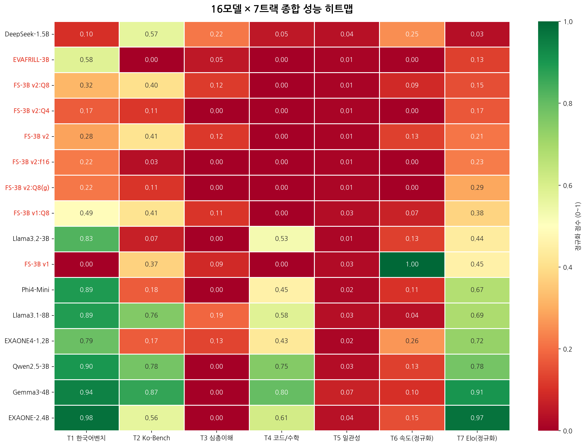
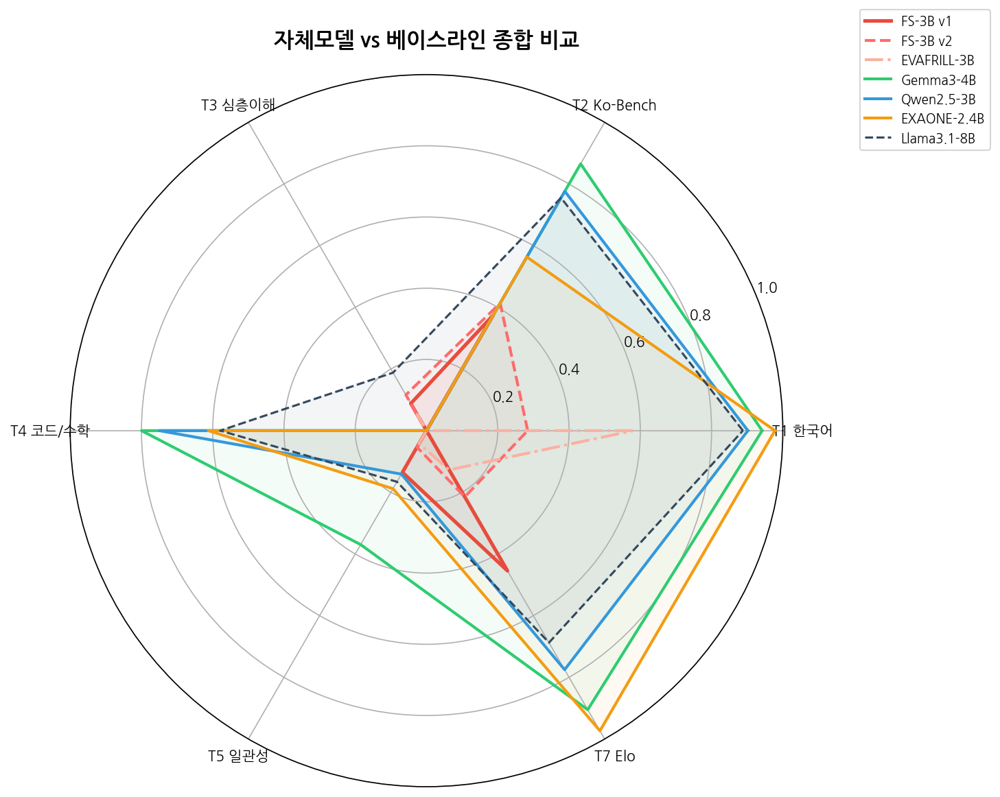
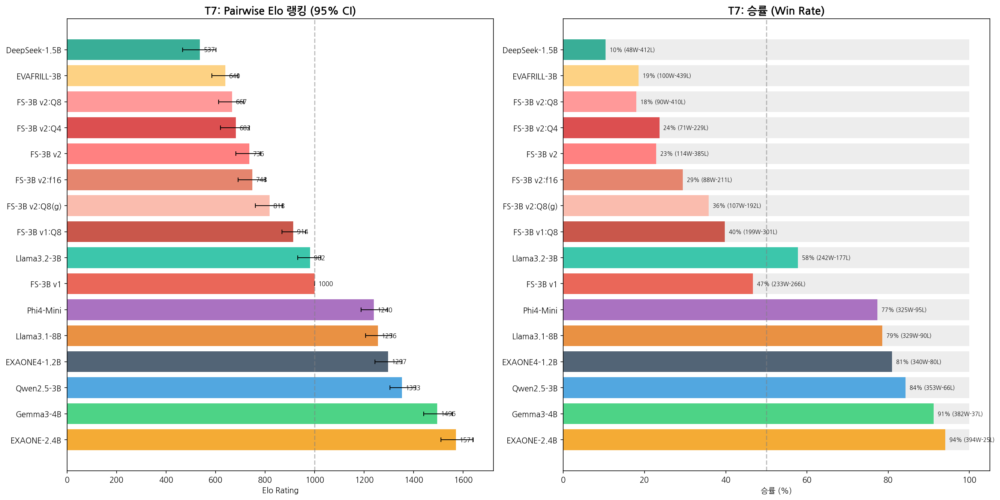

# KoBench Suite (ko-llm-bench-suite)

[한국어](README.md)

A Korean LLM evaluation toolkit. It has two parts: a **standard-benchmark module** that runs public benchmarks under identical conditions, and **7 tracks** that use the suite's own items to look at generation quality, consistency and speed.

[](LICENSE)
[](https://www.python.org)
[](tests/)
[](https://pathcosmos.github.io/ko-llm-bench-suite/)

**Final report: <https://pathcosmos.github.io/ko-llm-bench-suite/>** (Korean). Three custom 3B models compared with 30 public models (dense 3B class and MoE A3B class) under identical conditions on one H200.

---

## Contents

- [Components](#components)
- [Final report and key results](#final-report-and-key-results)
- [Quick start](#quick-start)
- [Standard benchmarks](#standard-benchmarks-kobenchstandard)
- [The 7 tracks](#the-7-tracks)
- [System requirements](#system-requirements)
- [Project structure](#project-structure)
- [Testing](#testing)
- [Example: Frankenstallm evaluation (v0.2)](#example-frankenstallm-evaluation-v02)
- [Operations](#operations) (remote Ollama, EVAFRILL mode, checkpoints, multi-machine, wizard, dashboard)

## Components

| Component | Entry point | What it does |
|---|---|---|
| **Standard benchmarks** (`kobench/standard`) | `python -m kobench.standard.*` | Runs public benchmarks under identical conditions with lm-evaluation-harness, vLLM (BF16) and llama.cpp. Multiple choice is scored by option log-likelihood and perplexity by bits-per-byte, so base models are compared fairly. Includes 13 generation tasks (rule, code-execution and LLM-judge scoring), multi-turn scenarios, thinking on/off, a unified protocol, serving performance, GGUF quantization loss, dev-only setting selection and bootstrap CIs. |
| **7 tracks** (`kobench.py`) | `python kobench.py --config ...` | Uses the suite's own items for KoBEST, Korean generation (dual judge), deep Korean understanding, code and math, consistency, speed and pairwise Elo. Backends: Ollama, vLLM and llama.cpp (OpenAI-compatible), EVAFRILL. |

The two parts are independent. Use the standard benchmarks for careful comparison with public models; use the 7 tracks to sweep many models quickly through Ollama.

## Final report and key results

Report: **<https://pathcosmos.github.io/ko-llm-bench-suite/>** (Korean; source [`reports/final/report.html`](reports/final/report.html), commentary [`narrative.json`](reports/final/narrative.json), chart data [`data.json`](reports/final/data.json)). Measured in 2026-11 on one H200 with vLLM 0.33 in BF16.

- **Models**: JANSORI (3B base), frankenstallm (3B instruct), EVAFRILL-Mo (2.94B Mamba-2 hybrid, pretrain and slerp), and 30 public models: Qwen3.5/3.6, Qwen3, Qwen2.5, kanana-1.5/2, SmolLM3, Gemma 4, Llama 3.2, Phi-4-mini, EXAONE 3.5, Nemotron 3/3.5, ERNIE 4.5. Base models are compared with base models and instruct with instruct; MoE models list total and active parameters.
- **Setting selection**: per-model settings (decoding, system instruction, checkpoint) were chosen on dev splits only, with rules registered before measurement. Test results were never used for selection.

### Unified protocol (34 models on one line)

Every model gets the same raw prompt with no chat template (log-likelihood cloze, few-shot, URIAL). Nine areas (knowledge, professional/medical, factuality/bias, math, code, instruction following, conversation/generation quality, multi-turn, language modeling) are averaged with equal weight (0 to 1).

| Rank | Model | Type | Total / active params | Composite |
|---:|---|---|---|---:|
| 1 | qwen3.6-35b-a3b | instruct, MoE | 35B / 3B | 0.585 |
| 2 | qwen3.5-35b-a3b | instruct, MoE | 35B / 3B | 0.581 |
| 3 | qwen3.5-35b-a3b-base | base, MoE | 35B / 3B | 0.577 |
| 4 | qwen3-30b-a3b-2507 | instruct, MoE | 30.5B / 3.3B | 0.571 |
| 8 | qwen3-4b-2507 (best dense) | instruct, dense | 4.0B | 0.492 |
| 10 | exaone-3.5-2.4b | instruct, dense | 2.4B | 0.467 |
| 30 | llama-3.2-3b (lowest public model) | base, dense | 3.2B | 0.246 |
| 31 | **JANSORI** | base, dense | 3.2B | 0.181 |
| 32 | **EVAFRILL-Mo slerp** | instruct, hybrid | 2.94B | 0.155 |
| 33 | **frankenstallm** | instruct, dense | 3.0B | 0.152 |
| 34 | **EVAFRILL-Mo pretrain** | base, hybrid | 2.94B | 0.151 |

### Other observations

- **Only language modeling ranks near the top**: on Korean bits-per-byte (wiki40b_ko) JANSORI scores 0.752, 4th of 15 base models. Knowledge multiple choice (KMMLU, HAE-RAE, Belebele, ...) is near chance for all three custom models, and math and code are near zero.
- **Multiple choice (ko_mc_v1 mean)**: best base kanana-2-30b-a3b-base 74.7, best dense base qwen3-4b-base 64.1, JANSORI 29.6, EVAFRILL pretrain 28.4.
- **Thinking sampling**: with greedy decoding, qwen3.5-4b keeps thinking until the context ends and gets truncated. Re-run with the README's recommended sampling, IFEval-Ko rises from 31.9% to 79.2%, KorMedMCQA from 62.1% to 80.1%, and multi-turn scenario pass from 0.31 to 0.82.
- **Serving performance**: at 64 concurrent requests, MoE A3B output throughput (about 3.5k to 4.8k tok/s) is a quarter to half of dense 3B to 4B models (about 9k to 15k tok/s), consistent with the memory-bandwidth cost of reading 30B-class weights every step.
- **GGUF quantization**: Q8_0 is within the 95% CI of f16 GGUF. Q4_K_M shows a significant loss on JANSORI KoBEST: -0.9 pp [-1.8, -0.2].
- **Caveats**: the unified protocol's code tasks use base-model continuation format, so some instruct models that do not follow it score near zero on MBPP+. Judge scores for Qwen-family models may carry self-preference bias (the judge is Qwen3.6-35B-A3B). Public benchmarks may be in public models' training data. Bugs found and fixed during measurement, with their effect, are listed in the report appendix.

## Quick start

```bash
git clone https://github.com/pathcosmos/ko-llm-bench-suite.git
cd ko-llm-bench-suite
pip install -r requirements.txt          # 7 tracks
pip install -r requirements-dev.txt      # tests (optional)
```

### Standard benchmarks

Requires a CUDA GPU. The verified versions are pinned in [`requirements-standard.txt`](requirements-standard.txt) (vLLM 0.33.0, lm-eval 0.4.13); a fresh venv is recommended.

```bash
pip install -r requirements-standard.txt
python -c "import nltk; nltk.download('punkt_tab')"            # data for the IFEval scorer

python -m kobench.standard.run --list                                         # models, suites, pinned revisions
python -m kobench.standard.run --download --models qwen3-4b-base              # download the pinned revision
python -m kobench.standard.run --models qwen3-4b-base --suite ko_mc_v1        # multiple choice (finished tasks are skipped)
python -m kobench.standard.gen run   --models qwen3-4b-2507 --suite gen_v1 --variant A   # generation
python -m kobench.standard.gen score --models qwen3-4b-2507 --suite gen_v1 --variant A   # rule and code scoring
python -m kobench.standard.judge run --models qwen3-4b-2507 && python -m kobench.standard.judge score
python -m kobench.standard.perf --models qwen3-4b-2507                        # serving performance
python -m kobench.standard.final_data --regen && python -m kobench.standard.final_report   # report
```

### 7 tracks

```bash
bash setup.sh                            # installs Ollama and judge models (or install manually below)
ollama pull qwen2.5:7b-instruct && ollama pull exaone3.5:7.8b     # judges
ollama pull qwen2.5:3b                   # a model to evaluate (example)

python kobench.py --config configs/examples/frankenstallm.yaml               # full run
python kobench.py --config configs/examples/frankenstallm.yaml --tracks 1 4 6
python kobench.py --config configs/examples/frankenstallm.yaml --report-only # report from existing results
```

Configuration example:

```yaml
project:
  name: "My Evaluation"
  output_dir: "./results"
  reports_dir: "./reports"

backend:
  type: ollama            # ollama | vllm | llamacpp (vLLM and llama.cpp take an OpenAI-compatible server url)
  url: "http://localhost:11434"

models:
  - name: "qwen2.5:3b"
    tags: [baseline]

tracks:
  enabled: [1, 2, 3, 4, 5, 6, 7]

judge:
  dual_enabled: true
  primary:   {model: "qwen2.5:7b-instruct", weight: 0.6}
  secondary: {model: "exaone3.5:7.8b", weight: 0.4}

sampling:
  temperature: 0.7
  top_p: 0.9
  max_tokens: 2048
  seed: 42
```

See [`configs/default.yaml`](configs/default.yaml) for all options.

## Standard benchmarks (`kobench/standard`)

Details (Korean): [docs/standard-benchmarks.md](docs/standard-benchmarks.md)

| Area | Suites and tasks | Scoring |
|---|---|---|
| Korean multiple choice | `ko_mc_v1`: KoBEST, KMMLU, HAE-RAE, CLIcK, Belebele-ko, Global-MMLU-ko / `ko_mc_ext_v1`: KMMLU-Redux, KMMLU-Pro, KoBALT-700 (gated, non-commercial) | option log-likelihood, bootstrap 95% CI |
| English multiple choice | `en_mc_v1`: MMLU, ARC-Challenge, HellaSwag, Winogrande | option log-likelihood |
| Language modeling | `ppl_v1`: wiki40b_ko, wikitext-2 | bits-per-byte (tokenizer-independent) |
| Generation | `gen_v1`: HRM8K (strict, `\boxed` required), IFEval-Ko, KorMedMCQA / KoBBQ / TruthfulQA-ko / K2 knowledge (generative MC), KoMT, LogicKor, K2 generation, ko-arena-hard, KoSimpleQA, HumanEval+, MBPP+ | answer rules, sandboxed code execution, LLM judge (Qwen3.6-35B-A3B) |
| Multi-turn | `scenario_v1`: 300 procedurally generated scenarios in 10 categories (3-5 turns); history = the model's own answers or reference answers | rules |
| Unified protocol | `uni_mc_v1` + `uni_v1`: the same raw prompt for every model, no chat template | normalized mean over 9 areas |
| Performance | `perf`: throughput, TTFT and TPOT at 1-64 concurrent requests, shared-prefix caching on/off, VRAM | client-side measurement |
| Quantization | GGUF f16, Q8_0, Q4_K_M (llama.cpp) vs BF16 (vLLM) | paired differences on the same items and tokens |

Principles:

- Public models only run with a pinned HF revision (commit SHA); dataset revisions are pinned in the configs too.
- **Table A** uses one protocol for every model; **table B** uses each model's dev-selected settings. Selection rules were registered before measurement in `configs/standard/dev_selection.yaml`.
- Generation tables report malfunction metrics alongside scores: repetition loops, duplicate 3-grams, language drift, template leakage, empty answers, truncation. Generation settings are the best-quality candidate on dev that meets the malfunction limits (loops ≤2%, language drift ≤2%, leakage ≤0.5%, truncation ≤5%).
- Custom models are evaluated with their training tokenizer and format (`configs/standard/formats.yaml`). EVAFRILL-Mo generates with the suite's batch-invariant incremental decoding engine (`evafrill_engine.py`).
- Tables: `reports/standard/`, `reports/gen/`. Only summary JSON is committed (`results/{standard,gen,perf}/`); per-item outputs and scores contain dataset text and are not committed.

## The 7 tracks

| Track | Name | Description | LLM judge |
|------|------|------|:---------:|
| T1 | Korean Bench | 4 KoBEST tasks (BoolQ, COPA, SentiNeg, HellaSwag) | |
| T2 | Ko-Bench | Korean generation quality in 8 categories | O |
| T3 | Korean Deep | Deep Korean understanding (proverbs, honorifics, culture) | O |
| T4 | Code & Math | Python coding and math problems | |
| T5 | Consistency | Answer consistency over repeated questions | |
| T6 | Performance | Tokens/sec, latency, concurrency | |
| T7 | Pairwise Elo | Pairwise model comparison, Bradley-Terry Elo | O |

- **T1 Korean Bench**: accuracy on KoBEST BoolQ (true/false), COPA (causal reasoning), SentiNeg (negated sentiment) and HellaSwag (situation completion). The fallback items used when lm-eval is unavailable are not the real KoBEST, so their score keys carry a `custom_` prefix and their options are rotated deterministically to spread the answer position evenly. Answer extraction accepts only standalone capital letters (so the a and d inside English words are not read as choices). For base models, use the standard benchmarks' log-likelihood scoring.
- **T2 Ko-Bench**: single- and multi-turn generation in 8 categories (creative writing, summarization, translation, analysis, ...). Judges score fluency, accuracy, completeness and instruction following from 1 to 10, and multi-turn degradation is analyzed.
- **T3 Korean Deep**: proverbs, honorific/casual conversion, Korean cultural knowledge, four-character idioms.
- **T4 Code & Math**: code is scored by running test cases, math by the final answer.
- **T5 Consistency**: the same question three times; semantic consistency by cosine similarity.
- **T6 Performance**: tokens/sec, TTFT and concurrency. For engine-independent measurement, use the standard benchmarks' `perf`.
- **T7 Pairwise Elo**: the judge compares responses for every model pair (order swapped to reduce position bias) and Bradley-Terry Elo is computed.

Judge requirements: T2, T3 and T7 need `qwen2.5:7b-instruct` (about 4.7 GB) and `exaone3.5:7.8b` (about 4.8 GB) in Ollama. Without judges, run `--tracks 1 4 5 6`.

## System requirements

| Item | 7 tracks | Standard benchmarks |
|------|------|------|
| OS | Ubuntu 22.04+ | Linux |
| Python | 3.10+ | 3.12 (verified) |
| GPU | optional (CPU works, slowly); NVIDIA 16 GB+ recommended | CUDA GPU required. Dense 3B-class BF16 weights are about 6-8 GB; MoE 30-35B-class BF16 about 57-67 GiB (80 GB-class GPU or larger). Verified on an H200 (143 GB) |
| RAM | 16 GB (32 GB recommended) | at least the model size |
| Disk | 20-50 GB | about 6-8 GB per 3B-class model, about 60-70 GB per A3B-class model |

A full 7-track run over 13 models takes about 4-6 hours on an RTX 5060 Ti and can take days on CPU.

## Project structure

```
ko-llm-bench-suite/
├── kobench.py                 # 7-track entry point
├── kobench/
│   ├── config.py, runner.py   # configuration, generation (requests go to the configured backend)
│   ├── judge.py               # dual LLM-as-judge
│   ├── scoring.py, report.py  # scorecard + Bradley-Terry Elo, HTML/Markdown reports
│   ├── evafrill_runner.py, evafrill_server.py   # EVAFRILL direct PyTorch inference / HTTP server
│   ├── backends/              # base.py (ABC), ollama.py, openai_compat.py (vLLM, llama.cpp)
│   ├── tracks/                # T1-T7
│   └── standard/              # standard benchmarks
│       ├── run.py, registry.py, dev_search.py, report.py      # MC/PPL runner, configs, dev selection, tables
│       ├── gen.py, gen_data.py, gen_score.py, gen_report.py   # generation runner, items, scoring, tables
│       ├── judge.py, code_exec.py, scenario.py, unified.py    # judge, sandboxed code, multi-turn, unified protocol
│       ├── perf.py, llamacpp_lm.py, native/                   # serving performance, GGUF log-likelihood
│       ├── formats.py, evafrill_lm.py, evafrill_engine.py     # training formats, EVAFRILL backend and engine
│       ├── final_data.py, final_report.py                     # final report
│       └── tasks/             # custom lm-eval tasks (dev / custom / gen / uni)
├── configs/
│   ├── default.yaml, examples/                # 7-track configs
│   └── standard/              # models, suites, gen, unified, formats, dev_selection, best_settings
├── benchmarks/                # 7-track items (T2, T3, T4, T7)
├── results/                   # standard/, gen/, perf/: summary JSON only
├── reports/                   # standard/ and gen/ tables, final/ report
├── examples/frankenstallm/    # v0.2 7-track results archive (26 charts)
├── docs/standard-benchmarks.md
├── tests/                     # unit/, integration/
├── .github/workflows/pages.yml   # reports/final -> GitHub Pages
├── requirements.txt, requirements-dev.txt, requirements-standard.txt
└── pyproject.toml
```

## Testing

```bash
pytest tests/ -v                                         # 638 tests, no Ollama or GPU needed (mock-based)
pytest tests/unit/test_gen.py -q                         # one file
KOBENCH_GPU=1 KOBENCH_SLOW=1 pytest tests/               # + 6 tests: GPU engine, llama.cpp, live Ollama tokenization, dataset snapshots
pytest tests/ --cov=kobench --cov-report=html            # coverage
```

## Example: Frankenstallm evaluation (v0.2)

`examples/frankenstallm/` holds a v0.2 7-track evaluation of 13 models (5 custom + 8 baselines) on an RTX 5060 Ti 16GB with Ollama. It was measured before the later fixes to T1's fallback answer-position bias and option regex, so its T1 numbers may be affected. For the current comparison, see the [final report](#final-report-and-key-results).

| Rank | Model | T1 NLU | T2 Gen | T3 Deep | T7 Elo | Composite |
|:----:|-------|:------:|:------:|:------:|:------:|:----:|
| 1 | EXAONE3.5:7.8b | 74.0 | 7.2 | 72.0 | 1180 | **78.2** |
| 2 | Qwen2.5:7b-instruct | 72.5 | 7.0 | 68.0 | 1150 | **75.8** |
| 3 | Gemma3:4b | 65.0 | 6.8 | 64.0 | 1080 | **68.5** |
| 4 | Qwen2.5:3b | 60.5 | 6.5 | 58.0 | 1020 | **63.2** |
| 5 | Llama3.2:3b | 58.0 | 6.2 | 52.0 | 980 | **59.8** |

| Overall heatmap | Radar comparison | Elo ranking |
|---|---|---|
|  |  |  |

Observations at the time: T1 and T7 rankings correlated strongly (r=0.90), every model at 3B or below scored 0% on T4, and some custom v2 models scored below v1. All 26 charts are in `examples/frankenstallm/reports/visualizations/`.

## Operations

### Remote Ollama server

```yaml
backend:
  type: ollama
  url: "http://192.168.1.100:11434"
  remote: true
```

In remote mode, models are loaded and unloaded through the HTTP API and unloaded after the run to free VRAM. Network latency makes T6 results differ from local runs. SSH tunnel: `ssh -NL 11434:localhost:11434 user@gpu-server &`, then `OLLAMA_BASE_URL="http://localhost:11434" OLLAMA_REMOTE=1 python kobench.py --config my_config.yaml`.

### EVAFRILL mode

Models whose name contains `evafrill` (for example `evafrill-mo-3b-slerp`) run with direct PyTorch inference instead of Ollama (`kobench/evafrill_runner.py`; the source and checkpoint paths are constants at the top of that file). The YAML key `gpu.evafrill_strategy` sets how the GPU is shared with Ollama.

To run on another server, start the HTTP server there and point the client at it:

```bash
python -m uvicorn kobench.evafrill_server:app --host 0.0.0.0 --port 8000     # GPU server
EVAFRILL_HTTP_URL="http://gpu-server:8000" python kobench.py --config my.yaml # client
```

The standard benchmarks do not use this path; they use the `evafrill` lm-eval backend (`kobench/standard/evafrill_lm.py`) with the incremental decoding engine.

### Checkpoints and multiple machines

Each finished model is saved to `results/{track}_checkpoint.json`; re-running the same command skips finished models. When splitting a run across servers, give each a different checkpoint suffix.

```bash
EVAL_CHECKPOINT_SUFFIX="_a" python kobench.py --tracks 1 2 3                    # server A
OLLAMA_BASE_URL="http://gpu-server:11434" OLLAMA_REMOTE=1 \
EVAL_CHECKPOINT_SUFFIX="_b" python kobench.py --tracks 4 5 6 7                  # server B
python kobench.py --report-only                                                  # merge results
```

### Interactive wizard and dashboard

```bash
python kobench.py setup    # verify install, install Ollama and judges
python kobench.py eval     # pick models and tracks -> run -> results (starts the dashboard)
python kobench.py config   # generate a YAML config
python kobench.py status   # GPU, Ollama and model status
python kobench.py --config my.yaml --dashboard [--dashboard-port 9999]
```

The dashboard (`http://localhost:8888`) shows per-track progress, the current model and item, VRAM, error logs and estimated time remaining.

## Contributing

1. **Evaluate new models**: add them to `configs/standard/models.yaml` (standard benchmarks) or `configs/examples/` (7 tracks)
2. **New tracks or tasks**: `kobench/tracks/` (TrackEvaluator) or `kobench/standard/tasks/` (lm-eval tasks)
3. **More benchmark data**: `benchmarks/`
4. **Bug reports**: GitHub Issues

Before a PR, run `pytest tests/` and `ruff check kobench/`.

## License

[MIT](LICENSE)
